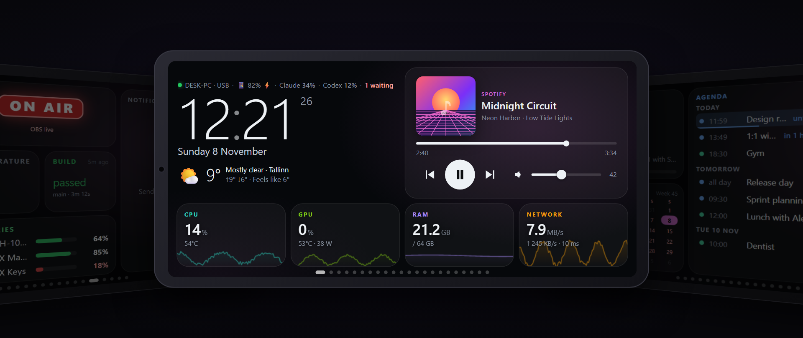

<p align="center"></p>

<h1 align="center">PhoneBox</h1>

<p align="center"><b>Transforme um celular Android antigo em um painel para o seu computador.</b><br>
Estatísticas do PC, sessões de IA, música e controles por toque via USB ou Wi-Fi.<br>
Windows, Linux e macOS. Sem root, sem conta ou serviço em nuvem.</p>

<p align="center">
  <a href="https://github.com/duartefilipe/phonebox/releases/latest"><b>Download</b></a> ·
  <a href="#início-rápido"><b>Início rápido</b></a>
</p>

<p align="center">
  
  
  <a href="LICENSE"></a>
</p>

<p align="center"></p>

Monte seu painel no editor visual pelo navegador: **135 widgets**, **30 templates**, várias páginas e prévia ao vivo.

## O que você pode fazer

| Uso | O que aparece no celular |
|---|---|
| **Monitorar o PC** | CPU, GPU, RAM, discos, rede e ping; gráficos, detalhes da GPU e controle de processos |
| **IA e código** | Cotas do Claude, Codex e Antigravity, tempos de reset e previsões; sessões locais do Claude Code, Codex e OpenCode; revisões do GitHub e status de CI |
| **Controles por toque** | Atalhos de apps e URLs, combinações de teclas e macros; controle de áudio, microfone, mídia, OBS e sistema |
| **Uso diário** | Música tocando, rádio, relógio, clima, calendários, notas, listas, pomodoro e temporizadores |
| **Automação** | Valores via webhook, controles do Home Assistant e regras que reagem à atividade do computador |

## Início rápido

Você precisa de um **celular Android 5+** e um computador compatível.

### 1. Instalar o agente no computador

**Windows 10/11 x64** — cole em um terminal PowerShell:

```powershell
irm https://raw.githubusercontent.com/duartefilipe/phonebox/main/setup.ps1 | iex
```

**Linux ou macOS:**

```sh
curl -fsSL https://raw.githubusercontent.com/duartefilipe/phonebox/main/setup.sh | bash
```

O setup baixa a versão mais recente, verifica o checksum, instala dependências e abre as configurações em <http://127.0.0.1:8765>.

### 2. Conectar o celular

**USB:** ative as opções de desenvolvedor → Depuração USB, conecte o cabo e aceite o prompt de autorização.

**Wi-Fi:** instale o APK do [último release](https://github.com/duartefilipe/phonebox/releases/latest), abra as configurações (`http://127.0.0.1:8765`), ative **Wi-Fi** em General, salve e reinicie. Depois escaneie o QR code de pareamento.

### 3. Personalizar

Abra <http://127.0.0.1:8765>, escolha um template, arraste e redimensione widgets e salve.

## Hub (vários PCs e celulares)

Rode o agente num servidor da casa (Docker / Portainer) para que vários celulares mostrem dados de vários PCs, com uma
página específica quando os PCs estão desligados. Veja [docker/README.md](docker/README.md).

## Plataformas

| | Windows | Linux | macOS |
|---|---|---|---|
| Builds | x64 | x64 / ARM64 | Apple silicon / Intel |
| CPU, RAM, discos, rede | ✓ | ✓ | ✓ |
| GPU | ✓ | NVIDIA / AMD | Apple silicon |
| Mídia | Sessions nativas | `playerctl` | `nowplaying-cli` |

## Segurança e privacidade

O servidor de configurações escuta em `127.0.0.1:8765`. Conexões USB e Wi-Fi usam TLS com certificado fixado. Sem telemetria, analytics ou contas próprias. Veja a [política de privacidade](PRIVACY.md).

## Licença

[MIT](LICENSE)
